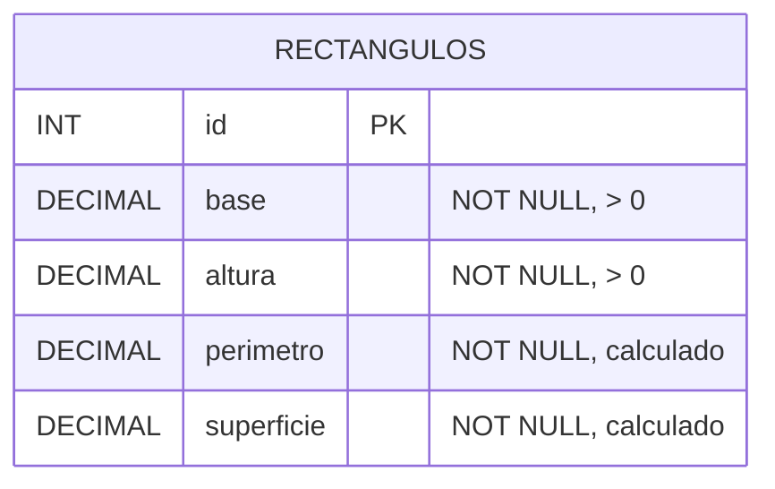

# Ejercicio 1 - Rectángulos

## Cómo correrlo

1. Ejecutar `db.sql` en MySQL.
2. Crear un archivo `.env` con `DB_PASSWORD=...`
3. `npm install` y después `npm run dev`
4. Probar con `pruebas.http`

## Diagrama entidad-relación

## Endpoints

| Método | Ruta | Descripción | Respuestas |
|---|---|---|---|
| GET | /rectangulos | Lista todos. Filtros opcionales `superficieMin` y `superficieMax` | 200, 400 |
| GET | /rectangulos/:id | Devuelve uno | 200, 400, 404 |
| POST | /rectangulos | Crea. Body: `{ base, altura }` | 201, 400 |
| PUT | /rectangulos/:id | Modifica. Body: `{ base, altura }` | 200, 400, 404 |
| DELETE | /rectangulos/:id | Elimina | 204, 400, 404 |

## Decisiones de diseño

- **Una sola tabla:** un rectángulo no se relaciona con nada más.
- **DECIMAL en vez de FLOAT:** FLOAT guarda valores aproximados (0.1 puede quedar como 0.100000001). Con DECIMAL los lados se guardan exactos con 2 decimales. Por eso la API solo acepta hasta 2 decimales: si aceptara más, MySQL redondearía el lado y no coincidiría con el perímetro calculado.
- **Superficie con 4 decimales:** al multiplicar dos lados de 2 decimales el resultado tiene hasta 4, así no se pierde precisión.
- **Perímetro y superficie se guardan aunque se puedan calcular:** lo pide la consigna, y además permite filtrar por superficie directamente en SQL.
- **El cliente solo manda los lados:** el servidor calcula perímetro y superficie. Si el cliente los manda, la API responde 400 en vez de ignorarlos, para que quede claro que no se aceptan.
- **CHECK en la tabla:** la regla de lados mayores que 0 también está en la base, como segunda barrera además de express-validator.
- **PUT y no PATCH:** para recalcular hacen falta los dos lados, así que se reemplaza el rectángulo completo.
- **Códigos HTTP:** 201 al crear, 204 al eliminar (sin contenido), 400 si falla una validación y 404 si el id no existe.
- **Límite de 1.000.000 por lado:** evita valores absurdos que no entren en las columnas DECIMAL.