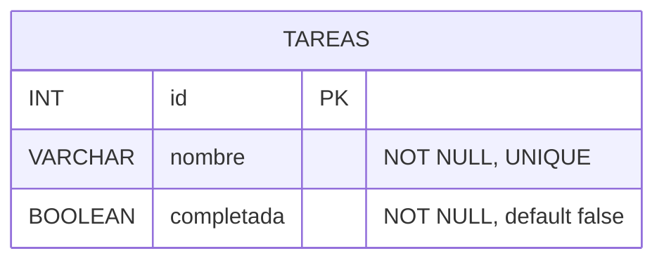

# Ejercicio 2 - Tareas

## Cómo correrlo

1. Ejecutar `db.sql` en MySQL.
2. Crear un archivo `.env` con `DB_PASSWORD=...`
3. `npm install` y después `npm run dev`
4. Probar con `pruebas.http`

## Diagrama entidad-relación

## Endpoints

| Método | Ruta | Descripción | Respuestas |
|---|---|---|---|
| GET | /tareas | Lista todas. Filtro opcional `estado=completadas` o `estado=pendientes` | 200, 400 |
| GET | /tareas/:id | Devuelve una | 200, 400, 404 |
| POST | /tareas | Crea. Body: `{ nombre, completada? }` | 201, 400 |
| PUT | /tareas/:id | Modifica. Body: `{ nombre, completada }` | 200, 400, 404 |
| DELETE | /tareas/:id | Elimina | 204, 400, 404 |

## Criterio para nombres iguales

Dos nombres se consideran iguales si coinciden después de:

1. Sacar los espacios del principio y del final.
2. Reemplazar los espacios repetidos del medio por uno solo.
3. Comparar sin distinguir mayúsculas ni acentos.

Entonces `"Comprar pan"`, `"  comprar   PAN "` y `"Cómprar pan"` son la misma tarea.

Los pasos 1 y 2 los hace la API antes de guardar, así que el nombre siempre se guarda limpio. El paso 3 lo hace MySQL con la intercalación `utf8mb4_0900_ai_ci` (`ai` = no distingue acentos, `ci` = no distingue mayúsculas), que se declara explícitamente en la columna para no depender de la configuración del servidor.

## Decisiones de diseño

- **Unicidad en dos lugares:** express-validator consulta la base antes de guardar y responde 400 con un mensaje claro. Además, la columna tiene `UNIQUE`, que con esa intercalación aplica el mismo criterio. Así, aunque alguien inserte directo en la base, no puede haber duplicados.
- **Al modificar**, la búsqueda de duplicados excluye a la propia tarea, para poder cambiarle el estado o las mayúsculas sin que choque consigo misma.
- **El estado es un BOOLEAN** porque solo hay dos estados posibles. En la API solo se acepta `true` o `false` (no `"si"`, `1` ni `"true"`), para que el tipo sea claro.
- **El filtro usa `completadas` / `pendientes`**, que se lee mejor en la URL que `true`/`false`. Cualquier otro valor da 400.
- **`completada` es opcional al crear:** una tarea nueva arranca pendiente. En el PUT es obligatoria porque PUT reemplaza la tarea completa.
- **Nombre de 3 a 100 caracteres:** evita nombres vacíos o sin sentido y entra en el `VARCHAR(100)`.
- **Códigos HTTP:** 201 al crear, 204 al eliminar, 400 si falla una validación (incluido el nombre repetido) y 404 si el id no existe.