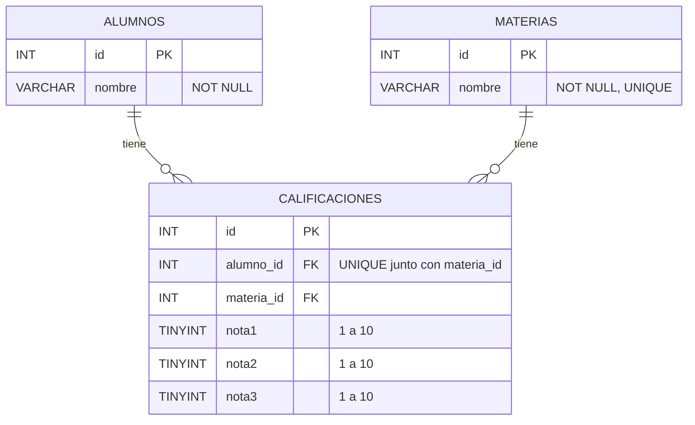

# Ejercicio 3 - Calificaciones

## Cómo correrlo

1. Ejecutar `db.sql` en MySQL.
2. Crear un archivo `.env` con `DB_PASSWORD=...`
3. `npm install` y después `npm run dev`
4. Probar con `pruebas.http` (en orden)

## Diagrama entidad-relación

Un alumno puede tener calificaciones en muchas materias y una materia puede tener calificaciones de muchos alumnos, pero cada par alumno-materia aparece una sola vez.

## Endpoints

| Método | Ruta | Descripción | Respuestas |
|---|---|---|---|
| GET | /materias | Lista materias | 200 |
| GET | /materias/:id | Devuelve una materia | 200, 400, 404 |
| POST | /materias | Crea. Body: `{ nombre }` | 201, 400 |
| PUT | /materias/:id | Modifica. Body: `{ nombre }` | 200, 400, 404 |
| DELETE | /materias/:id | Elimina | 204, 400, 404, 409 |
| GET | /alumnos | Lista alumnos | 200 |
| GET | /alumnos/:id | Devuelve un alumno | 200, 400, 404 |
| POST | /alumnos | Crea. Body: `{ nombre }` | 201, 400 |
| PUT | /alumnos/:id | Modifica. Body: `{ nombre }` | 200, 400, 404 |
| DELETE | /alumnos/:id | Elimina | 204, 400, 404, 409 |
| GET | /calificaciones | Lista. Filtros opcionales `alumnoId` y `materiaId` | 200, 400 |
| GET | /calificaciones/:id | Devuelve una | 200, 400, 404 |
| POST | /calificaciones | Crea. Body: `{ alumnoId, materiaId, notas: [n1, n2, n3] }` | 201, 400 |
| PUT | /calificaciones/:id | Modifica. Mismo body | 200, 400, 404 |
| DELETE | /calificaciones/:id | Elimina | 204, 400, 404 |

## Escala de notas

Las notas son **enteros del 1 al 10**, la escala que usa la UTN. Se validan en la API con express-validator y también en la base con `CHECK`.

## Decisiones de diseño

- **Materias en su propia tabla:** lo pide la consigna, y así el nombre de la materia está escrito una sola vez. Si se corrige, se corrige en un solo lugar.
- **Alumnos también en su propia tabla:** la consigna pide gestionar alumnos. Además, si el nombre se repitiera en cada calificación, corregirlo obligaría a cambiarlo en varias filas.
- **El nombre del alumno no es único:** dos alumnos distintos pueden llamarse igual, así que cada alumno se identifica por su `id`. El nombre de la materia sí es único, con el mismo criterio que en el Ejercicio 2 (sin distinguir mayúsculas, acentos ni espacios extra).
- **Unicidad alumno-materia en dos lugares:** express-validator lo controla al crear y al modificar (excluyendo el propio registro en el PUT) y responde 400 con un mensaje claro. La base tiene `UNIQUE(alumno_id, materia_id)` como última barrera.
- **Existencia de alumno y materia:** se verifica con express-validator antes de guardar, para devolver un mensaje claro. La clave foránea igual lo garantizaría en la base.
- **Las notas van como arreglo (`"notas": [8, 7, 9]`):** así se puede exigir que sean exactamente 3. Con campos sueltos (`nota1`, `nota2`...), una cuarta nota simplemente se ignoraría. En la base se guardan en tres columnas porque siempre son exactamente 3.
- **No se puede borrar un alumno o una materia con calificaciones:** la clave foránea lo impide y la API responde **409 Conflict**. Se eligió esto en lugar de borrar en cascada para no perder notas sin querer.
- **Respuestas con nombres:** las calificaciones se devuelven con el nombre del alumno y de la materia (usando JOIN), para que se entiendan sin hacer otras consultas.
- **Códigos HTTP:** 201 al crear, 204 al eliminar, 400 si falla una validación, 404 si el id no existe y 409 si un borrado viola la clave foránea.