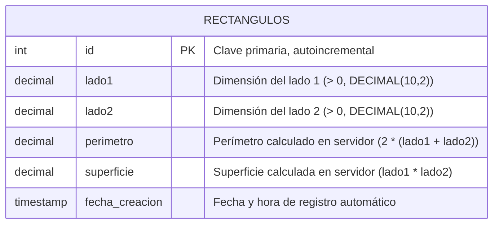

# Ejercicio 1: API de Gestión de Rectángulos

API RESTful desarrollada con ExpressJS y MySQL para la gestión, almacenamiento y cálculo de propiedades geométricas de rectángulos.

---

## 1. Fundamentación de Decisiones de Diseño

### 1.1 Modelo de Datos
- **Tipo de datos para los lados (`DECIMAL(10, 2)`):** Se seleccionó `DECIMAL` en lugar de `FLOAT` o `DOUBLE` para garantizar precisión matemática exacta y evitar errores de redondeo en operaciones de punto flotante en MySQL.
- **Persistencia de `perimetro` y `superficie`:** El enunciado solicita almacenar tanto los lados como el perímetro y la superficie. Esto permite realizar consultas analíticas o de filtrado directamente en base de datos sin recalcular en cada SELECT.
- **Cálculo exclusivo en el servidor:** Para asegurar la integridad y veracidad de los datos, el perímetro y la superficie **nunca son provistos por el cliente**. El servidor los calcula en base a `lado1` y `lado2` antes de ejecutar el `INSERT` o `UPDATE`. Cualquier solicitud que intente enviar `perimetro` o `superficie` en el cuerpo es rechazada explícitamente con un código de error `400 Bad Request`.

### 1.2 Diseño de la API REST
- **Arquitectura en capas:** Separación clara de responsabilidades en configuración (`config/`), rutas (`routes/`), validaciones (`validators/`), middlewares (`middlewares/`) y controladores (`controllers/`).
- **Validaciones exhaustivas con `express-validator`:**
  - **Cuerpo (`body`):** Se valida que `lado1` y `lado2` estén presentes, sean números y estrictamente mayores a cero. Se utiliza una regla personalizada `.custom()` para rechazar la presencia de campos no permitidos (`perimetro` y `superficie`).
  - **Parámetros de ruta (`param`):** Se valida que el `id` sea un entero positivo mayor que cero.
  - **Parámetros de consulta (`query`):** Se valida que filtros como `orden` (`asc`/`desc`), `limite` (entero 1-100) y `esCuadrado` (`true`/`false`) pertenezcan exclusivamente a los valores admitidos.
- **Códigos de respuesta HTTP semánticos:**
  - `200 OK`: Consultas exitosas, actualizaciones y eliminaciones.
  - `201 Created`: Creación exitosa de un recurso.
  - `400 Bad Request`: Parámetros, consultas o cuerpo con formato o valores inválidos.
  - `404 Not Found`: Rectángulo no encontrado por ID.
  - `500 Internal Server Error`: Errores no controlados de base de datos o de servidor.

---

## 2. Diagrama Entidad-Relación



---

## 3. Recursos y Endpoints de la API

| Método | Ruta | Descripción | Códigos HTTP |
| :--- | :--- | :--- | :--- |
| `GET` | `/` | Información general de la API y enlaces | `200` |
| `GET` | `/api/rectangulos` | Listar todos los rectángulos (soporta `?esCuadrado=true\|false`, `?orden=asc\|desc`, `?limite=N`) | `200`, `400` |
| `GET` | `/api/rectangulos/:id` | Obtener un rectángulo por su ID | `200`, `400`, `404` |
| `POST` | `/api/rectangulos` | Crear un rectángulo recibiendo únicamente `lado1` y `lado2` | `201`, `400` |
| `PUT` | `/api/rectangulos/:id` | Modificar un rectángulo recibiendo únicamente `lado1` y `lado2` | `200`, `400`, `404` |
| `DELETE` | `/api/rectangulos/:id` | Eliminar un rectángulo por su ID | `200`, `400`, `404` |

---

## 4. Instalación y Puesta en Marcha

### Requisitos previos
- Node.js (v18+)
- MySQL Server en ejecución

### Pasos
1. Instalar las dependencias:
   ```bash
   npm install
   ```

2. Configurar las variables de entorno en el archivo `.env`:
   ```env
   PORT=3001
   DB_HOST=localhost
   DB_PORT=3306
   DB_USER=root
   DB_PASSWORD=tu_contraseña_aqui
   DB_NAME=tp2_ejercicio1
   ```

3. Inicializar la base de datos (opcional, la aplicación la inicializa automáticamente al arrancar):
   ```bash
   npm run init-db
   ```
   O bien ejecutar manualmente el script `schema.sql` en MySQL.

4. Iniciar el servidor:
   ```bash
   # Modo producción
   npm start

   # Modo desarrollo (con recarga automática)
   npm run dev
   ```

5. Probar los endpoints:
   - Utilizar el archivo de pruebas `ejercicio1.http` con la extensión REST Client de VS Code o Thunder Client.
   - O ejecutar la suite de pruebas automatizadas:
     ```bash
     npm test
     ```
