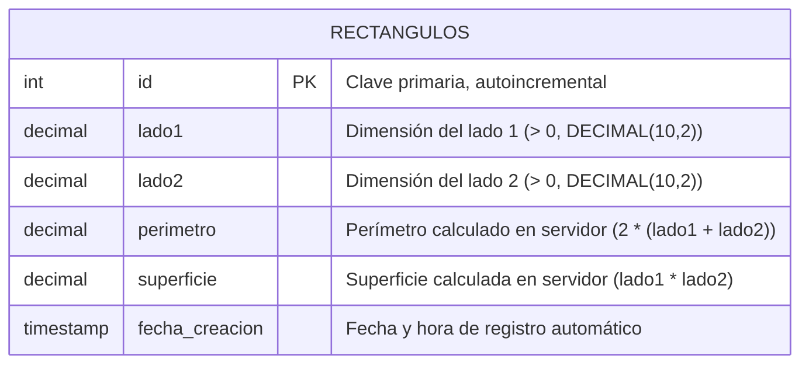

# Diagrama Entidad-Relación - Ejercicio 1: Rectángulos

## Modelo Entidad-Relación (Mermaid)

## Descripción de la Entidad

- **Entidad:** `rectangulos`
- **Propósito:** Almacenar las dimensiones geométricas fundamentales de figuras rectangulares y sus propiedades derivadas calculadas por el servidor.
- **Campos:**
  - `id` (INT, Clave Primaria, Auto-incremental): Identificador unívoco del rectángulo.
  - `lado1` (DECIMAL(10, 2), NOT NULL): Longitud del primer lado. Se restringe a valores estrictamente mayores a 0 mediante validación en la API.
  - `lado2` (DECIMAL(10, 2), NOT NULL): Longitud del segundo lado. Se restringe a valores estrictamente mayores a 0 mediante validación en la API.
  - `perimetro` (DECIMAL(10, 2), NOT NULL): Valor persistido calculado automáticamente mediante la fórmula `2 * (lado1 + lado2)`. La API rechaza cualquier intento del cliente de enviar este dato.
  - `superficie` (DECIMAL(10, 2), NOT NULL): Valor persistido calculado automáticamente mediante la fórmula `lado1 * lado2`. La API rechaza cualquier intento del cliente de enviar este dato.
  - `fecha_creacion` (TIMESTAMP, DEFAULT CURRENT_TIMESTAMP): Marca temporal de creación del registro.
