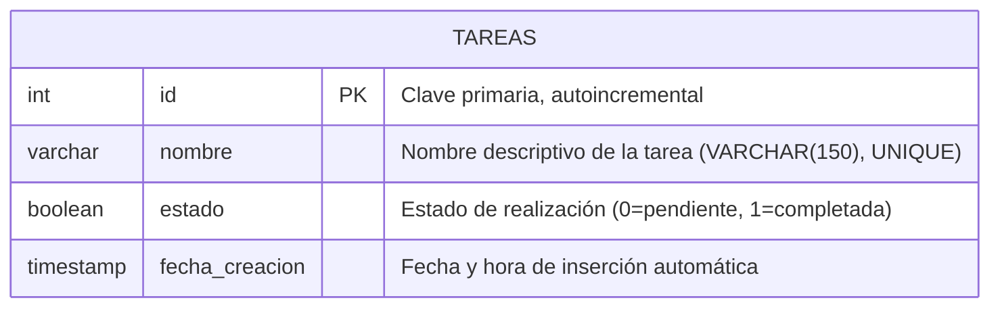

# Ejercicio 2: API de Gestión de Lista de Tareas

API RESTful desarrollada con ExpressJS y MySQL para administrar una lista de tareas, garantizando la unicidad de nombres mediante un criterio de comparación consistente y permitiendo el filtrado exhaustivo por estado (completadas / pendientes).

---

## 1. Fundamentación de Decisiones de Diseño

### 1.1 Modelo de Datos
- **Tipo de datos para el estado (`BOOLEAN` / `TINYINT(1)`):** En MySQL, el tipo `BOOLEAN` es un sinónimo de `TINYINT(1)`, donde `0` representa `false` (pendiente) y `1` representa `true` (completada). Se mapea automáticamente a tipo booleano nativo en las respuestas JSON de la API.
- **Índice y restricción única en `nombre`:** La tabla `tareas` posee una restricción `UNIQUE KEY (nombre)`. Esto asegura a nivel de motor de almacenamiento que no puedan coexistir dos tareas con la misma denominación.
- **Campo `fecha_creacion`:** Permite registrar la cronología y ordenar las tareas de manera ascendente o descendente.

### 1.2 Criterio de Comparación Consistente para Nombres de Tareas
Para evitar que los usuarios creen tareas semánticamente idénticas alterando mayúsculas, minúsculas o introduciendo espacios accidentales, se definió e implementó el siguiente criterio de comparación estricto:
1. **Trim de extremos:** Se eliminan los espacios en blanco al principio y al final del texto.
2. **Compactación de espacios intermedios:** Se reemplazan secuencias continuas de espacios contiguos (`\s+`) por un único espacio simple (` `).
3. **Conversión a minúsculas (Case-insensitivity):** Se evalúan todos los caracteres en minúsculas.

**Ejemplo:**
- `"Estudiar base de datos"`
- `"   estudiar    base de datos   "`
- `"ESTUDIAR BASE DE DATOS"`

Las tres cadenas anteriores son consideradas **exactamente iguales**. Al intentar registrar una segunda variante, la API responde con código `409 Conflict` impidiendo la duplicación.

### 1.3 Filtrado por Estado
El endpoint `GET /api/tareas` acepta el parámetro de consulta `estado`:
- `?estado=completadas` (o `true` / `1`): Retorna únicamente tareas donde `estado = true`.
- `?estado=pendientes` (o `false` / `0`): Retorna únicamente tareas donde `estado = false`.
- Sin parámetro o `?estado=todas`: Retorna la totalidad de las tareas.
- Cualquier valor ajeno (ej. `?estado=archivadas`) es interceptado por `express-validator` y rechazado con `400 Bad Request`.

### 1.4 Validaciones Exhaustivas con `express-validator`
- **Cuerpo (`body`):**
  - `nombre`: obligatorio, tipo string, no vacío, longitud de 2 a 150 caracteres.
  - `estado`: valor booleano estricto (`true` o `false`).
- **Parámetros de ruta (`param`):**
  - `id`: entero positivo mayor a cero.
- **Parámetros de consulta (`query`):**
  - `estado`: validado con lista blanca `['completadas', 'pendientes', 'todas', 'true', 'false']`.
  - `orden`: `asc` o `desc`.
  - `limite`: entero entre 1 y 100.

---

## 2. Diagrama Entidad-Relación



---

## 3. Recursos y Endpoints de la API

| Método | Ruta | Descripción | Códigos HTTP |
| :--- | :--- | :--- | :--- |
| `GET` | `/` | Documentación y estado de la API | `200` |
| `GET` | `/api/tareas` | Listar todas las tareas (o filtrar con `?estado=completadas\|pendientes`) | `200`, `400` |
| `GET` | `/api/tareas/:id` | Obtener una tarea por ID | `200`, `400`, `404` |
| `POST` | `/api/tareas` | Crear una nueva tarea (valida unicidad de nombre) | `201`, `400`, `409` |
| `PUT` | `/api/tareas/:id` | Modificar nombre y estado de una tarea | `200`, `400`, `404`, `409` |
| `PATCH` | `/api/tareas/:id/estado` | Modificar únicamente el estado booleano de una tarea | `200`, `400`, `404` |
| `DELETE` | `/api/tareas/:id` | Eliminar una tarea por ID | `200`, `400`, `404` |

---

## 4. Instalación y Puesta en Marcha

### Requisitos previos
- Node.js (v18+)
- MySQL Server en ejecución

### 4.1 Configuración de variables de entorno
Configurar las credenciales en el archivo `.env`:
```env
PORT=3002
DB_HOST=localhost
DB_PORT=3306
DB_USER=root
DB_PASSWORD=tu_contraseña_aqui
DB_NAME=tp2_ejercicio2
```

### 4.2 Inicialización y Ejecución en PowerShell
```powershell
# Desde la raíz del repositorio, ingresar a la carpeta:
cd "Merlo Brac, Federico\Ejercicio 2"

# Instalar dependencias (solo la primera vez):
npm install

# Inicializar la base de datos (opcional, se inicializa automáticamente al arrancar):
npm run init-db

# Iniciar el servidor (Puerto 3002):
npm start

# Modo desarrollo con recarga automática:
npm run dev

# Ejecutar suite de pruebas automatizadas:
npm test
```

### 4.3 Inicialización y Ejecución en Bash / Git Bash
```bash
# Desde la raíz del repositorio, ingresar a la carpeta:
cd "Merlo Brac, Federico/Ejercicio 2"

# Instalar dependencias (solo la primera vez):
npm install

# Inicializar la base de datos:
npm run init-db

# Iniciar el servidor (Puerto 3002):
npm start

# Modo desarrollo con recarga automática:
npm run dev

# Ejecutar suite de pruebas automatizadas:
npm test
```

### 4.4 Pruebas con archivo HTTP
Con el servidor en ejecución, abrir el archivo [ejercicio2.http](file:///c:/Users/Usuario/Desktop/tp2%20prog4/tup-programacion-IV-2026-tp2/Merlo%20Brac,%20Federico/Ejercicio%202/ejercicio2.http) con la extensión REST Client de VS Code o Thunder Client y hacer clic en **"Send Request"** sobre cada caso de prueba.
