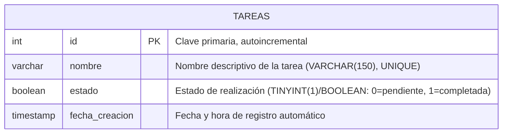

# Diagrama Entidad-Relación - Ejercicio 2: Tareas

## Modelo Entidad-Relación (Mermaid)

## Descripción de la Entidad

- **Entidad:** `tareas`
- **Propósito:** Administrar el ciclo de vida de actividades o tareas personales/académicas, asegurando la no duplicidad de nombres y el control del estado de finalización.
- **Campos:**
  - `id` (INT, Clave Primaria, Auto-incremental): Identificador numérico único de la tarea.
  - `nombre` (VARCHAR(150), NOT NULL, UNIQUE): Nombre de la tarea. La API y la base de datos impiden duplicados aplicando un criterio de normalización consistente (insensible a mayúsculas y espacios superfluos).
  - `estado` (BOOLEAN / TINYINT(1), NOT NULL, DEFAULT FALSE): Indicador del estado de la tarea (`false` = pendiente, `true` = completada).
  - `fecha_creacion` (TIMESTAMP, DEFAULT CURRENT_TIMESTAMP): Registro temporal de inserción.
