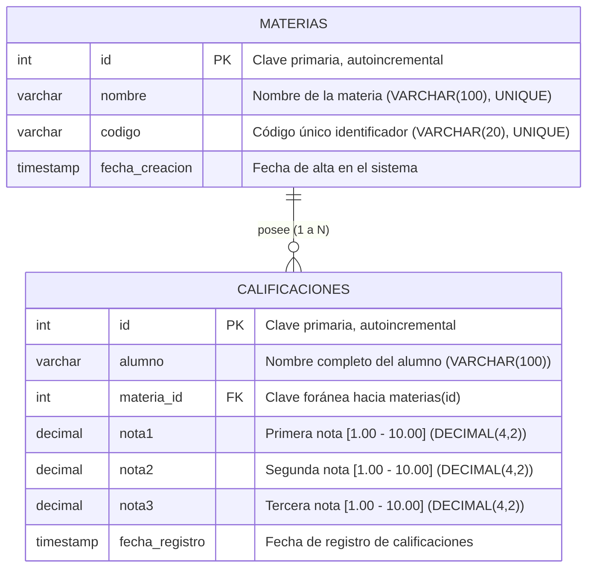

# Ejercicio 3: API de Gestión de Calificaciones de Alumnos

API RESTful desarrollada con ExpressJS y MySQL para administrar alumnos, materias de la carrera y sus correspondientes calificaciones, garantizando la integridad referencial con claves foráneas, la obligatoriedad de exactamente tres notas dentro de la escala oficial definida y la regla estricta de unicidad alumno-materia tanto al crear como al modificar.

---

## 1. Fundamentación de Decisiones de Diseño

### 1.1 Modelo de Datos y Normalización
- **Separación de entidades (`materias` y `calificaciones`):**
  Siguiendo la Tercera Forma Normal (3FN), las materias se modelan en su propia tabla independiente con identificador primario (`id`), nombre oficial (`nombre`) y código unívoco (`codigo`). La tabla `calificaciones` almacena el nombre del alumno y referencia a `materias` mediante una clave foránea `materia_id`.
- **Integridad referencial (`FOREIGN KEY`):**
  La clave foránea `fk_calificaciones_materia` posee la regla `ON DELETE RESTRICT` y `ON UPDATE CASCADE`. Esto impide eliminar una materia si existen registros de calificaciones asociados a ella, protegiendo el historial académico.
- **Restricción de Unicidad (`UNIQUE KEY uq_alumno_materia`):**
  Se define una clave única compuesta `(alumno, materia_id)`. Esto garantiza a nivel de base de datos que sea físicamente imposible asentar dos registros de notas para el mismo estudiante en una misma materia.
- **Tipo de datos para las notas (`DECIMAL(4, 2)`):**
  Permite almacenar calificaciones precisas con hasta dos dígitos decimales (ejemplo: `7.50`, `9.25`, `10.00`), evitando discrepancias por imprecisión de coma flotante.

### 1.2 Escala de Calificaciones Definida y Documentada
Se adopta formalmente la **Escala Numérica Universitaria Argentina (UTN)**:
- **Rango permitido:** De `1.00` a `10.00` (ambos inclusive).
- **Exactitud exigida:** Deben suministrarse obligatoriamente y sin excepción **exactamente tres notas** (`nota1`, `nota2`, `nota3`). Si se omite alguna de ellas o se reciben valores inferiores a 1.00 o superiores a 10.00, la API rechaza la petición con código `400 Bad Request`.
- **Criterio de aprobación (enriquecido):** La API calcula automáticamente el `promedio = (nota1 + nota2 + nota3) / 3` y determina la condición del alumno (`"Aprobado"` si promedio $\ge 6.00$ y cada nota individual $\ge 4.00$, o `"Desaprobado"` en caso contrario).

### 1.3 Regla de Unicidad Alumno - Materia
Tanto al **crear** (`POST`) como al **modificar** (`PUT`):
1. La API normaliza el nombre del alumno (eliminando espacios superfluos y homogeneizando la comparación).
2. Se verifica en la base de datos si ya existe un registro asociado a ese alumno en la materia indicada.
3. Si existe, la solicitud es rechazada inmediatamente con código HTTP `409 Conflict`, impidiendo la sobreescritura accidental o duplicación de actas de examen.

### 1.4 Verificación de Existencia de la Materia
Antes de persistir cualquier registro en `calificaciones`, la API consulta la tabla `materias` para constatar que el `materia_id` provisto existe efectivamente. Si no existe, se rechaza la petición con código `400 Bad Request` indicando que la materia no fue encontrada.

### 1.5 Validaciones Exhaustivas con `express-validator`
- **Cuerpo (`body`):**
  - `alumno`: obligatorio, string no vacío de 3 a 100 caracteres.
  - `materia_id`: obligatorio, número entero positivo.
  - `nota1`, `nota2`, `nota3`: obligatorias, números en el rango `[1.00, 10.00]`.
- **Parámetros de ruta (`param`):**
  - `id`: entero positivo mayor que cero.
- **Parámetros de consulta (`query`):**
  - `materia_id`: entero positivo para filtrar.
  - `alumno`: cadena de texto para búsqueda parcial.

---

## 2. Diagrama Entidad-Relación



---

## 3. Recursos y Endpoints de la API

### Materias
| Método | Ruta | Descripción | Códigos HTTP |
| :--- | :--- | :--- | :--- |
| `GET` | `/api/materias` | Listar todas las materias | `200` |
| `GET` | `/api/materias/:id` | Obtener una materia por su ID | `200`, `400`, `404` |
| `POST` | `/api/materias` | Crear una nueva materia (`nombre`, `codigo`) | `201`, `400`, `409` |

### Calificaciones
| Método | Ruta | Descripción | Códigos HTTP |
| :--- | :--- | :--- | :--- |
| `GET` | `/api/calificaciones` | Listar todas las calificaciones (admite `?materia_id=X` y `?alumno=Y`) | `200`, `400` |
| `GET` | `/api/calificaciones/:id` | Obtener una calificación por ID | `200`, `400`, `404` |
| `POST` | `/api/calificaciones` | Crear calificación (exige 3 notas y unicidad alumno-materia) | `201`, `400`, `409` |
| `PUT` | `/api/calificaciones/:id` | Modificar calificación (valida existencia de materia, 3 notas y unicidad) | `200`, `400`, `404`, `409` |
| `DELETE` | `/api/calificaciones/:id` | Eliminar una calificación por ID | `200`, `400`, `404` |

---

## 4. Instalación y Puesta en Marcha

### Requisitos previos
- Node.js (v18+)
- MySQL Server en ejecución

### Pasos
1. Instalar dependencias:
   ```bash
   npm install
   ```

2. Configurar el archivo `.env`:
   ```env
   PORT=3003
   DB_HOST=localhost
   DB_PORT=3306
   DB_USER=root
   DB_PASSWORD=tu_contraseña_aqui
   DB_NAME=tp2_ejercicio3
   ```

3. Inicializar la base de datos (opcional, la aplicación la inicializa automáticamente al arrancar):
   ```bash
   npm run init-db
   ```

4. Iniciar el servidor:
   ```bash
   # Modo producción
   npm start

   # Modo desarrollo (con recarga automática)
   npm run dev
   ```

5. Ejecutar pruebas automatizadas:
   ```bash
   npm test
   ```
   O utilizar el archivo `ejercicio3.http` en VS Code.
