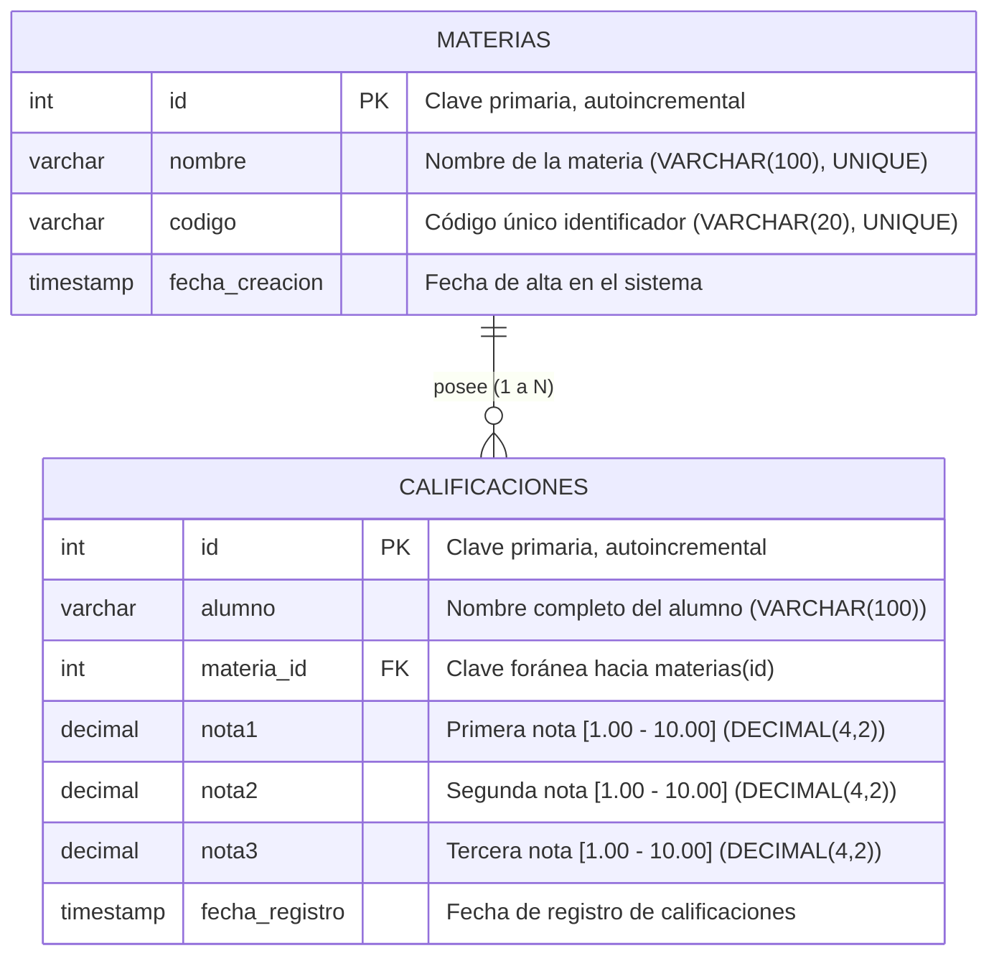

# Diagrama Entidad-Relación - Ejercicio 3: Calificaciones

## Modelo Entidad-Relación (Mermaid)

## Descripción de las Entidades y Relaciones

- **Entidad `materias`:**
  - `id` (INT, PK, AUTO_INCREMENT): Identificador unívoco de la materia.
  - `nombre` (VARCHAR(100), NOT NULL, UNIQUE): Nombre oficial de la cátedra/asignatura.
  - `codigo` (VARCHAR(20), NOT NULL, UNIQUE): Código de materia (ej. `PROG-4`, `BD-2`).
  - `fecha_creacion` (TIMESTAMP): Momento de alta de la asignatura.

- **Entidad `calificaciones`:**
  - `id` (INT, PK, AUTO_INCREMENT): Identificador unívoco del acta/registro de notas.
  - `alumno` (VARCHAR(100), NOT NULL): Apellido y nombre del estudiante evaluado.
  - `materia_id` (INT, NOT NULL, FK): Referencia a la materia correspondiente en la tabla `materias`.
  - `nota1` (DECIMAL(4, 2), NOT NULL): Primera nota en escala `[1.00 - 10.00]`.
  - `nota2` (DECIMAL(4, 2), NOT NULL): Segunda nota en escala `[1.00 - 10.00]`.
  - `nota3` (DECIMAL(4, 2), NOT NULL): Tercera nota en escala `[1.00 - 10.00]`.
  - `fecha_registro` (TIMESTAMP): Momento de asentamiento de las notas.

- **Relación y Restricciones:**
  - **Relación 1 a N:** Una materia puede tener múltiples registros de calificaciones asociados a distintos alumnos. Cada registro de calificación pertenece obligatoriamente a una única materia existente.
  - **Clave Foránea (`fk_calificaciones_materia`):** Con `ON DELETE RESTRICT` para evitar eliminar materias que tengan notas asentadas, y `ON UPDATE CASCADE` para mantener la consistencia referencial.
  - **Regla de Unicidad (`uq_alumno_materia`):** Restricción `UNIQUE KEY (alumno, materia_id)` para impedir a nivel relacional y de API que se asiente más de un registro de notas para la misma combinación alumno-materia.
